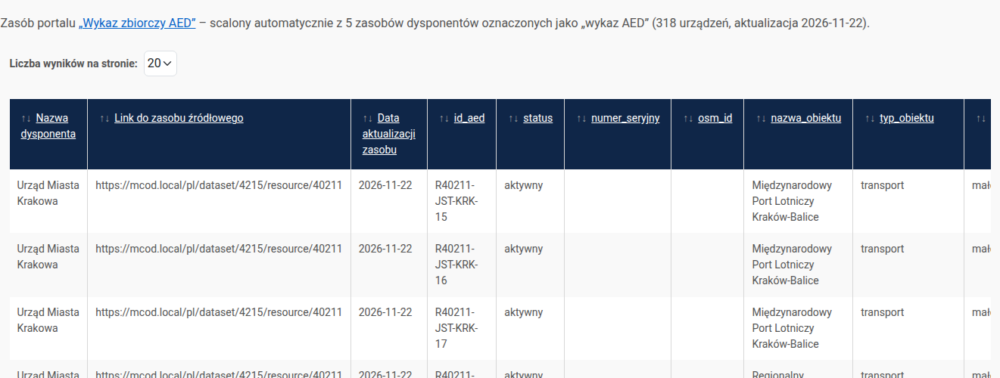

<p align="center"></p>

# AED na ratunek: wykaz zbiorczy defibrylatorów w dane.gov.pl

**„Pokaż, gdzie jest AED. Każda minuta się liczy.”** Rozwiązanie zadania **„Misja AED – Dane na ratunek”** (Ministerstwo Cyfryzacji, HackNation 2026).

Przy nagłym zatrzymaniu krążenia liczy się każda minuta, a informacja o tym, gdzie jest najbliższy AED, jest dziś rozproszona po stronach gmin, PDF-ach i mapach. Sprawdziliśmy to na danych:

- tylko **47 z 1771** automatycznie przejrzanych stron gmin ma wykaz adresów AED (dolna granica);
- **36 z 66** miast na prawach powiatu nie publikuje żadnej listy;
- w dane.gov.pl dane o AED publikuje **5 instytucji, każda w innym układzie kolumn**.

**Nasze rozwiązanie nie jest osobną aplikacją.** Rozbudowaliśmy oficjalny kod portalu dane.gov.pl tak, żeby sam zbierał zasoby z AED od wielu dysponentów i publikował je jako **jeden wykaz zbiorczy**, tak jak dziś robi to z wykazem DGA.



> **Dla jury:** instrukcja krok po kroku, gdzie sprawdzić każde wymaganie z zadania: [`INSTRUKCJA_DLA_JURY.md`](INSTRUKCJA_DLA_JURY.md) (także jako PDF: [`kampania/instrukcja_dla_jury_AED.pdf`](kampania/instrukcja_dla_jury_AED.pdf)).

## Spis najważniejszych rzeczy

- **Wykaz zbiorczy AED działa w backendzie dane.gov.pl.** Dysponent zaznacza przy zasobie „Zasób zawiera wykaz AED”, portal sprawdza plik, a w nocy skleja wszystkie takie zasoby w jeden wykaz z informacją, skąd pochodzi każdy wiersz. Działa to tak samo jak istniejący wykaz DGA. Kod: `backend/mcod/resources/aed_utils.py` i `tasks/aed.py`.
- **Dane można dodać ręcznie albo automatycznie.** Ręcznie przez panel dostawcy, automatycznie przez harwester XML z nowym polem `containsAedList`.
- **Wzorcowy zakres danych** jest w `schemat/wzorcowy_zakres_danych_AED.xlsx`. Najważniejsze nowe pole to `zabezpieczenie`, czyli czy szafka jest zamknięta na klucz. W OpenStreetMap ta informacja jest przy 3 z 18 297 punktów.
- **Mamy prawdziwe dane, nie demo:** 1279 AED z 74 źródeł, prawie wszystkie z położeniem z urzędowego rejestru adresów (`dane/`). Bierzemy je tylko z oficjalnych źródeł, czyli od urzędów i instytucji. Dane z OpenStreetMap nie trafiają do wykazu.
- **Strona /pl/aed** wygląda jak reszta portalu i przechodzi test WCAG 2.2 AA bez błędów (`portal/src/app/pages/aed/`).
- **Kampania i prezentacja** są w `kampania/`: logo, księga znaku, opis kampanii, instrukcja dla dysponenta i prezentacja PDF.

## Materiały wymagane w zadaniu

| Wymaganie | Plik |
|---|---|
| Prezentacja (PDF) | [`kampania/prezentacja_AED_na_ratunek.pdf`](kampania/prezentacja_AED_na_ratunek.pdf) |
| Wzorcowy zakres danych (XLSX) | [`schemat/wzorcowy_zakres_danych_AED.xlsx`](schemat/wzorcowy_zakres_danych_AED.xlsx) |
| Prototyp | strona `/pl/aed` i wykaz zbiorczy w lokalnym portalu (sekcja „Uruchomienie”), zrzuty w [`kampania/zrzuty/`](kampania/zrzuty/) |
| Kod źródłowy | [`backend/`](backend/), [`portal/`](portal/), [`crawler/`](crawler/) |
| Logo (JPG, PNG, PDF + SVG) | [`kampania/logo/`](kampania/logo/) |
| Księga znaku (PDF) | [`kampania/ksiega_znaku_AED_na_ratunek.pdf`](kampania/ksiega_znaku_AED_na_ratunek.pdf) |
| Opis kampanii | [`kampania/opis_kampanii_AED_na_ratunek.pdf`](kampania/opis_kampanii_AED_na_ratunek.pdf) |

**Bez uruchamiania:** zrzuty ekranu są w `kampania/zrzuty/`, a całość w prezentacji. **Z uruchomieniem:** lokalny portal http://localhost:4300/pl/aed i panel https://admin.mcod.local (sekcja „Uruchomienie”).

## Użyte technologie

| Warstwa | Technologie |
|---|---|
| Backend portalu (kod dane.gov.pl, GPL-3.0) | Python, Django, PostgreSQL, Elasticsearch, Celery, RabbitMQ, Redis, Docker Compose |
| Frontend portalu | Angular 18, TypeScript, Bootstrap, Leaflet + Leaflet.markercluster |
| Standard danych | Frictionless Table Schema, XSD harwestera dane.gov.pl, CSV / XLSX / GeoJSON |
| Crawler | Python, lxml, openpyxl, xlrd; API dane.gov.pl, Wikidata (SPARQL), sitemapy stron gmin |
| Geokodowanie | Państwowy Rejestr Granic (PRG, GUGiK): lokalny indeks punktów adresowych w SQLite |
| Jakość i dostępność | axe-core (WCAG 2.2 AA), Playwright, testy jednostkowe Django |
| Kampania | SVG generowane w Pythonie, HTML → PDF (Chrome), czcionka Roboto |

## Gdzie co jest

| Katalog / plik | Zawartość |
|---|---|
| `backend/` | Backend dane.gov.pl (Django, `mcod`) + nasze zmiany oznaczone `# MISJA AED` |
| `portal/` | Frontend dane.gov.pl (Angular) + strona `src/app/pages/aed/` i pozycja „Mapa AED” w menu |
| `schemat/wzorcowy_zakres_danych_AED.xlsx` | **Wzorcowy zakres danych (wymagany plik xlsx)** |
| `schemat/tableschema_aed.json`, `schemat/szablon_aed_dla_dysponenta.csv` | Wzorzec dla maszyn i szablon dla dysponenta |
| `dane/aed_zbiorczy.csv` / `.geojson` / `.xlsx`, `dane/aed_mobilne.csv` | Zbiór zebrany przez crawler |
| `dane/raport_jakosci.json`, `dane/metadane_dane_gov_pl.xml` | Raport jakości, metadane dla harwestera (zgodne z XSD) |
| `zrodla/rejestr_zrodel.csv` | Rejestr źródeł i partnerów kampanii ze statusami A–F |
| `zrodla/miasta_na_prawach_powiatu.csv` | Przegląd 66 miast |
| `dane_surowe/gminy/odkryte.json` | Wynik automatycznego przeglądu stron gmin (status każdej gminy) |
| `crawler/` | Crawler, normalizacja, geokodowanie (PRG/GUGiK), walidator, eksport |
| `kampania/` | Logo (`logo/`), księga znaku, opis kampanii, instrukcja dla dysponenta, prezentacja, zrzuty ekranu |

## Zmiany w backendzie portalu (`backend/`)

| Element | Plik |
|---|---|
| Flaga zasobu `contains_aed_list` + model `AggregatedAEDInfo` + migracja | `mcod/resources/models.py`, `migrations/0076_misja_aed.py` |
| Walidacja pliku w panelu administracyjnym (brakujące kolumny wymagane) | `mcod/resources/forms.py`, `admin.py` |
| Wzorzec, odczyt, walidacja wierszy, scalanie, zbiór i zasoby wykazu | `mcod/resources/aed_constants.py`, `aed_utils.py` |
| Zadanie Celery (codziennie 03:45) + komenda `create_main_aed` | `mcod/resources/tasks/aed.py`, `management/commands/create_main_aed.py` |
| Endpoint API `GET /aggregated-aed-info` | `mcod/routes.py`, `resources/views.py` |
| Harwester XML 1.14: element `<containsAedList>` | `data/harvester/xml_import_otwarte_dane_1_14.xsd`, `mcod/harvester/serializers.py` |
| Testy | `mcod/resources/tests/test_aed_utils.py`, `test_main_aed.py` |

## Uruchomienie

**Frontend portalu na lokalnym backendzie** (zalecane, wykaz zbiorczy jako tabela):
```bash
cd portal && npm ci && npx ng serve --configuration lokalny --port 4300   # http://localhost:4300/pl/aed
```
Wariant bez lokalnego backendu (dane z produkcyjnego API dane.gov.pl i z `src/assets/aed`): `npx ng serve --configuration aed`.

**Pełny portal lokalnie** (backend, panel administracyjny, wykaz zbiorczy):
```bash
cd backend
cp env.sample .env && cp mcod/settings/local.py.sample mcod/settings/local.py   # + FIELD_ENCRYPTION_KEYS, DISCOURSE_FORUM_ENABLED=false
docker compose -f docker-compose.local.yml build
docker compose -f docker-compose.local.yml run --rm mcod-local-run python manage.py init_mcod_db
docker compose -f docker-compose.local.yml up -d mcod-local-admin mcod-local-api mcod-local-celery mcod-nginx
# /etc/hosts: 127.0.0.1 mcod.local api.mcod.local admin.mcod.local cms.mcod.local
# demo: 5 dysponentów z zasobami „wykaz AED” + scalenie
docker exec -w /usr/src/mcod_backend mcod-celery python manage.py shell -c "exec(open('data/aed/demo/wlasciciel_wykazu.py').read())"
docker exec -w /usr/src/mcod_backend mcod-celery python manage.py shell -c "exec(open('data/aed/demo/seed_demo.py').read())"
docker exec -w /usr/src/mcod_backend mcod-celery python manage.py create_main_aed
curl -k https://api.mcod.local/aggregated-aed-info
```
Panel administracyjny: https://admin.mcod.local (login `admin@mcod.local`, hasło `testadmin123!`, konto testowe z dokumentacji portalu).

Uwagi do uruchomienia:
- Podsieć Dockera zmieniona na `10.213.18.0/24`, bo domyślna kolidowała z innymi sieciami na maszynie deweloperskiej.
- Kontenery Discourse (forum) są wyłączone.

**Crawler:**
```bash
python3 -m venv .venv && .venv/bin/pip install -r requirements.txt   # + pdftotext (poppler-utils)
.venv/bin/python -m crawler prg              # jednorazowo: lokalny indeks adresów PRG (GUGiK, ~565 MB)
.venv/bin/python -m crawler gminy            # przegląd stron gmin z listy Wikidaty (Wikidata + sitemap + PRG)
.venv/bin/python -m crawler                  # pełny przebieg: źródła → ujednolicenie → dane/ + portal/src/assets/aed
.venv/bin/python -m crawler waliduj plik.csv # walidator dla dysponenta
```

**Materiały kampanii:** `python kampania/logo.py`, `ksiega.py`, `opis_kampanii.py`, `instrukcja_dysponenta.py`, `prezentacja.py`.

## Wyniki (22.11.2026)

- **1279 AED stacjonarnych**, z czego 1243 ze współrzędnymi, plus 299 AED w pojazdach. Dane z **74 źródeł** w 14 województwach.
- **Przegląd stron gmin** (lista stron z Wikidaty, 2165 z 2479 gmin; strona odpowiedziała w 1771):

  | Wynik | Gmin |
  |---|---|
  | wykaz adresów AED na stronie | 47 |
  | piszą o AED bez wykazu | ok. 220 |
  | brak podstrony o AED (strona główna + sitemap) | ok. 1500 |

- **66 miast na prawach powiatu:** 36 nie publikuje żadnej listy AED.
- **Rejestr źródeł:** 97 podmiotów (dysponenci, agregatory, firmy) ze statusem udostępniania.
- **Demo w lokalnym portalu:** 5 urzędów, 5 zasobów, 1 wykaz zbiorczy z 318 AED (307 ze współrzędnymi).
- **WCAG 2.2 AA** (axe-core): 0 naruszeń na stronie /pl/aed, na komputerze i na telefonie.

## Ograniczenia

- **Dane ze stron urzędów** są informacją publiczną bez jawnej licencji. Docelowo publikuje je sam dysponent w dane.gov.pl.
- **Wartości wywnioskowane z opisów** (np. zabezpieczenie „u personelu”) mają flagę jakości.
- **Nie obchodzimy zabezpieczeń serwisów.** Serwer uml.lodz.pl blokuje pobieranie automatyczne, więc użyto kopii pobranej ręcznie.
- **API Warszawy** wymaga tokenu.
- **Geokoder GUGiK** ma limity, dlatego geokodujemy lokalnie z PRG.
- **Dane OpenStreetMap** (licencja ODbL) są tylko warstwą porównawczą i nie trafiają do wykazu.
- **Testy backendu wymagające bazy** nie były uruchamiane w CI. Mechanizm sprawdzono w lokalnym portalu (demo powyżej).

## Użycie AI

Zgodnie z §2 ust. 8 regulaminu: kod, analiza źródeł danych i projekty materiałów powstały z pomocą asystenta AI (Claude, Anthropic). Zakres prac, decyzje projektowe, weryfikacja wyników i odpowiedzialność za rozwiązanie należą do zespołu.

## Licencje

- Kod portalu (`backend/`, `portal/`) i nasze zmiany: GPL-3.0.
- Krój Roboto: SIL OFL.
- Dane OSM w `portal/src/assets/aed/osm_aed_punkty.json`: ODbL, © współtwórcy OpenStreetMap.
